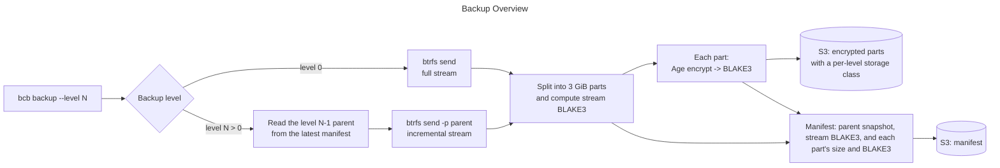
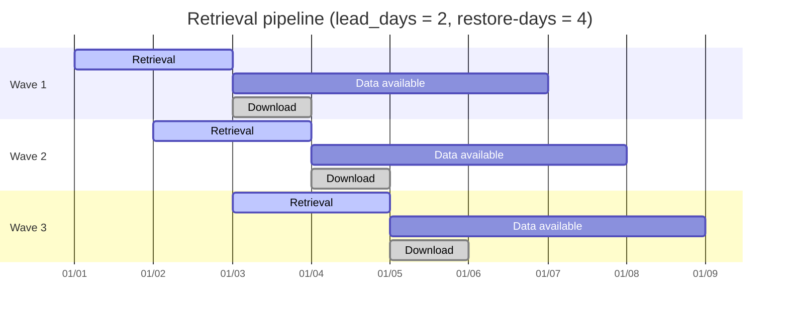
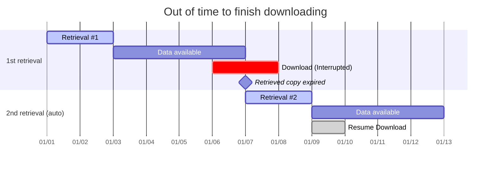

# Btrfs Cold Backup

`bcb` backs up Btrfs subvolume snapshots to an object storage service for offsite backup.

Features:

- Full and incremental multi-level backups.
- Built for [AWS S3 Glacier Deep Archive][s3-gda] cold storage, optimal storage costs.
- End-to-end encryption via [Age][age].
- Integrity verification via [BLAKE3][b3].



To restore, apply level 0, level 1, …, level N in order; each incremental requires its parent level to be present on the target.

> For ZFS: [zrb](https://github.com/ziteh/zfs-remote-backup)

## Usage

```bash
sudo bcb check                          # validate config and connectivity
bcb backup --level 0                    # run a backup
bcb restore --task <name> --level 0 --date <YYYYMMDDHHMM> --target <path> --private-key <key>

bcb genkey --output ./bcb_private.key   # generate an age key pair
bcb list                                # list backups on S3
bcb verify                              # audit backups without triggering retrieval
```

Config path defaults to `/etc/bcb/config.yaml`; override with `--config`. Run `bcb --help` or `bcb <command> --help` for the full option list.

### Config

```yaml
# /etc/bcb/config.yaml
base_dir: /var/lib/bcb/
age_public_key: age1xxxxxxxxxxxxxxxxxxxxxxxxxxxxxxxxxxxxxxxxxxxxxxxxxxxxxxxxxx
s3:
  bucket: my-backup-bucket
  prefix: btrfs-backups/ # Empty, or ends with "/" and does not start with "/"
  endpoint: "" # Leave empty for AWS S3, or specify custom endpoint for S3-compatible services
  region: us-east-1
  storage_class:
    manifest: STANDARD # Must be readable without retrieval: STANDARD, STANDARD_IA, ONEZONE_IA or GLACIER_IR
    backup_data: # One entry per backup level; a level without an entry is an error
      - DEEP_ARCHIVE # Level 0 (full backup)
      - DEEP_ARCHIVE # Level 1
      - GLACIER      # Level 2
tasks:
  - name: example_task # Letters, digits, '.', '_' and '-' only: it becomes a directory name
    description: Example backup task
    subvolume: /mnt/data
    snapshot_dir: /mnt/.snapshots # Must not be shared with another enabled task
    enabled: true
```

`base_dir` is bcb's local working directory: it holds the lock file, resume state, daily log files, and the temporary split/encrypted parts during backup and restore. Its filesystem needs free space roughly equal to one full backup. bcb sets its permissions to 0700 on every run.

`backup_data` accepts STANDARD, STANDARD_IA, ONEZONE_IA, GLACIER_IR, GLACIER and DEEP_ARCHIVE.

### Snapshots

`bcb` does **not** create snapshots; it expects them in each task's `snapshot_dir`, created by [btrbk][btrbk] with `snapshot_name bcb_level<N>` and `timestamp_format long`:

```text
bcb_level<N>.<YYYYMMDD>T<hhmm>
```

- `bcb backup --level N` picks the newest matching snapshot.
- The snapshot must have been taken from the task's `subvolume` (btrfs Parent UUID), and a level-N parent is matched by UUID, not just name. A replaced source (e.g. new disk) fails until a level 0 backup starts a new chain.
- Timestamps (snapshot names, `--date`, manifests) are the snapshot's local time with no zone. On a host that observes DST, the hour repeated when clocks fall back can make a newer snapshot sort as older, or collide with an existing name; run bcb on a host without DST.
- A level-N (N > 0) backup requires the level-(N-1) parent snapshot from the latest backup, and the level-N snapshot must be newer.
- btrbk's same-minute suffix (`_<n>`) is not supported; bcb fails naming the snapshot, delete or rename it.
- Backups are idempotent: a completed snapshot is skipped, an interrupted one resumes. Tasks run sequentially; one failing task doesn't block the others.
- While a level of a task has an unfinished backup, backing up another level of that task fails until it is finished, or abandoned by deleting its state file and parts directory.

## Restoring

AWS S3 Glacier objects **require** retrieval before download.

`bcb restore` requests retrieval for the next batch, downloads whatever is currently retrievable, and exits — re-run until it prints `restore complete`. Exit code 2 means in progress, exit 0 means done, so a scheduler can just retry. A failed part download is logged and skipped; the next run retries it.

- `--restore-tier` / `--restore-days`: retrieval speed/cost and how long a retrieved copy stays downloadable.
- `s3.restore.expected_download_kbps` / `s3.restore.lead_days`: pace retrieval to available bandwidth instead of requesting everything at once. `expected_download_kbps` is in kilobit/s (e.g. the download number your ISP advertises); when unsure, a conservative (lower) estimate is safer. With pacing on, `--restore-days` must exceed the lead window by at least a day.
- Restore levels in order onto the same target (level 0 first); each incremental needs its parent already restored.
- If wrapped in a systemd timer, add `SuccessExitStatus=2` or every in-progress retry is treated as a failure.





> Waves above are illustrative; actual requests are paced by a rolling byte budget (lead_days x expected_download_kbps), not fixed daily batches.

## S3 Layout

```text
<prefix>backup-data/<subvolume>/bcb_level<N>_<YYYYMMDDhhmm>/snapshot.part-NNNNNN.age
<prefix>manifests/<subvolume>/bcb_level<N>_<YYYYMMDDhhmm>/manifest.yaml
<prefix>manifests/<subvolume>/latest.yaml
```

`<subvolume>` is the subvolume path with `/` replaced by `_`. `manifest.yaml` describes one backup; `latest.yaml` records the newest backup of each level, which the next incremental uses as its parent. Both carry a `format_version`, and bcb refuses a manifest whose major version it doesn't know.

## Retention

`bcb` **never** deletes from S3; use bucket lifecycle rules.

Every object is tagged `bcb-backup-level` (`0`, `1`, ... or `manifest`) so one lifecycle rule per level covers all subvolumes.

Leave `manifest` objects unexpired. Don't expire a level that a later incremental still depends on, and respect each storage class's minimum duration.

## Documentation

- [Periodic backup example](docs/periodic-backup-example.md) — btrbk config, systemd units, failure alerting (ready-to-copy files in [contrib/](contrib/README.md))
- [Restore drill runbook](docs/restore-drill-runbook.md)

## Development

```bash
cargo fmt && cargo clippy && cargo build && cargo test
```

**E2E:** requires Docker and [Multipass](https://multipass.run); the script creates and sets up the VM on first run.

```bash
bash scripts/run-vm-tests.sh
```

The e2e and VM suites are compiled into the same `cargo test` run, but each test skips itself (reporting "ok" either way) when its required environment variables aren't set — run with `cargo test -- --nocapture` to see the "skipping: ..." messages that distinguish an actual pass from a skip.

## TODO

- [x] CI (GitHub Actions: test, clippy, fmt)
- [x] Failure alerting (e.g. systemd OnFailure= notification unit)
- [ ] Release packaging
- [ ] Parallel part encryption/upload (worker pool)
- [ ] Protect parent snapshots of incremental chains from deletion (no btrfs equivalent of `zfs hold`; likely needs a check against btrbk retention)
- [ ] `restore --dry-run` and a `--force` passthrough for `btrfs receive`
- [x] Resumable restore: keep downloaded parts across runs so an interrupted restore only fetches (and re-requests archive retrieval for) the missing parts
- [x] `bcb verify`: audit chain completeness, part existence/size, storage class, and freshness without triggering an archive retrieval
- [ ] `bcb verify --deep`: sample-retrieve and BLAKE3-verify actual part contents (retrieval cost/latency, so off by default; for periodic drills)
- [ ] Add btrbk to VM for E2E testing
- [ ] `--download-kbps` override `expected_download_kbps`

## License

[Apache License 2.0](LICENSE)

[s3-gda]: https://aws.amazon.com/s3/storage-classes/glacier/
[age]: https://github.com/filosottile/age
[b3]: https://github.com/BLAKE3-team/BLAKE3
[btrbk]: https://github.com/digint/btrbk
