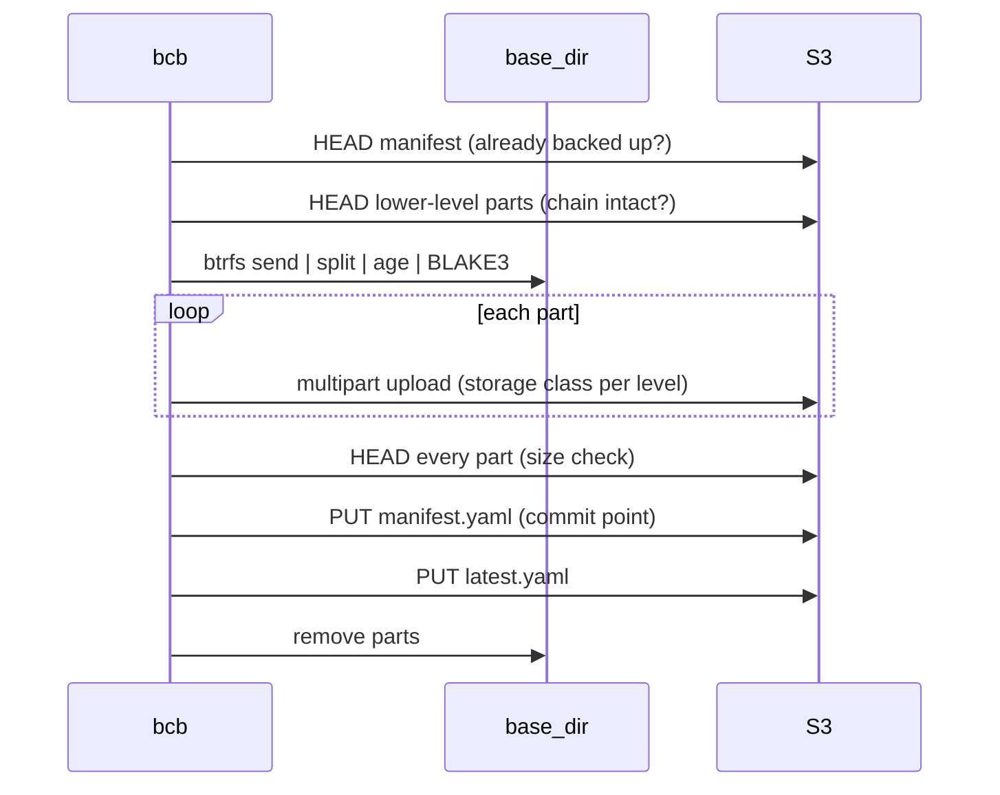

# Btrfs Cold Backup

`bcb` is an offsite cold-backup tool for Btrfs subvolume snapshots. It targets [Amazon S3 Glacier Deep Archive][s3-classes] and is built around that class's retrieval, minimum-duration and per-object billing constraints, to minimize storage and retrieval cost without weakening integrity guarantees.

- Multi-level backup: full and incremental. Snapshots are created by [btrbk][btrbk].
- E2EE: data is encrypted with [age][age] on the host before uploading.
- Integrity: [BLAKE3][b3] hashes per part and per stream.
- Resumable: backup and restore persist progress and continue after an interruption.
- No deletion: bcb never deletes from S3; retention is delegated to bucket lifecycle rules.

> For ZFS: [zrb](https://github.com/ziteh/zfs-remote-backup)

> [!NOTE]
> This repo contains LLM-assisted code; please review and validate it as appropriate.

## Design

bcb is specifically designed for S3 Glacier Deep Archive.

| Constraint                                                                                                  | bcb behavior                                                                                                                                                                              |
| ----------------------------------------------------------------------------------------------------------- | ----------------------------------------------------------------------------------------------------------------------------------------------------------------------------------------- |
| Objects are unreadable until retrieved, billed per GB and per request. [^retrieval]                         | Manifests are stored in a class readable without retrieval (`storage_class.manifest`, e.g. STANDARD). Chain checks and `bcb verify` use HEAD and LIST only and never trigger a retrieval. |
| Minimum storage duration of 180 days; earlier deletion or overwrite is billed for the remainder. [^classes] | A backup whose manifest exists is skipped and never re-uploaded. bcb never deletes; expiry is set by lifecycle rules.                                                                     |
| ~40 KB billed overhead per archived object; requests billed per object. [^classes]                          | The send stream is split into 3 GiB parts, which bounds object and request count.                                                                                                         |
| A retrieved copy is downloadable only for the requested number of days. [^retrieval]                        | Retrieval is paced to the download bandwidth. An expired copy is re-requested.                                                                                                            |
| Large full backups are costly to store and slow to retrieve.                                                | Incremental levels, each with its own storage class.                                                                                                                                      |
| Data is held by a third party for years.                                                                    | Parts are encrypted on the host. The private key is needed only for restore. Part and stream BLAKE3 hashes are recorded in the manifest.                                                  |

> S3 figures are AWS's published values at the time of writing.

[^classes]: [Amazon S3 storage classes][s3-storage-class-intro], [Amazon S3 pricing][s3-pricing]
[^retrieval]: [Understanding archive retrieval options][s3-retrieval]

### Backup levels

A level-N backup is a `btrfs send -p` against the newest backup of any lower level, as in Unix `dump`: with no level 1 newer than the latest level 0, a level 2 builds on the level 0 directly, so a schedule may skip levels. Restoring a backup requires its chain of parents restored first, so a backup must remain on S3 while any backup depends on it. See [ADR 0002](docs/decision/0002-incremental-parent-is-newest-lower-level.md).

## Backup workflow

`bcb backup --level N` processes each enabled task sequentially. Per task:

1. **Select snapshot**: the newest `bcb_level<N>.*` snapshot in `snapshot_dir`. If its manifest exists on S3, the task is skipped.
2. **Check chain** (level > 0): the parent is the deepest lower-level backup recorded in `latest.yaml`, matched to a local snapshot by btrfs UUID. HEAD every part of every lower level; abort if any is missing or has a different size.
3. **Check space**: `base_dir` must have free space for about one full stream.
4. **Send and encrypt**: run `btrfs send` (`-p` for incrementals), hash the whole stream, split it into 3 GiB parts, then encrypt and hash each part into `base_dir`.
5. **Upload**: one S3 object per part, sent as multipart chunks, with the level's storage class and a `bcb-backup-level` tag.
6. **Confirm**: HEAD every part and compare its size.
7. **Commit**: write `manifest.yaml`, then `latest.yaml`. A backup exists once its manifest exists.
8. **Clean up**: remove the local parts and state.



### Resume

Progress is persisted in a state file under `base_dir`. Re-running the same command resumes the backup.

| Interrupted during | Behavior on next run                                                                                             |
| ------------------ | ---------------------------------------------------------------------------------------------------------------- |
| Send / encrypt     | Partial parts are discarded and the send restarts.                                                               |
| Upload             | Local part hashes are re-checked; only parts not yet on S3 are uploaded. Orphaned multipart uploads are aborted. |
| Confirm            | A part that is missing or has a different size is re-uploaded.                                                   |
| After manifest     | Only `latest.yaml` is written.                                                                                   |

- Each level has its own state, so other levels can run while a backup of one is unfinished, e.g. while a level 0 spends weeks uploading. Only one bcb runs at a time, so stop the long run, run the other level, then resume it. Stopping during send/encrypt restarts the send; stopping during upload loses at most the part in flight.
- An unfinished incremental whose parent has been superseded (a lower level completed meanwhile) is abandoned automatically and the newest snapshot is backed up against the new parent. Parts it already uploaded stay on S3 until lifecycle expiration; the warning in the log lists them.
- To abandon an unfinished backup manually, delete its state file (`state-level<N>.yaml`) and parts directory.

### Oversize guard

Ransomware that encrypts the data makes the next incremental about as large as what it encrypted, even when that is only one shared folder. With `oversize_guard` set, an incremental is checked after the send and before any upload: it is held back if it is larger than `min_size_gib` and larger than `rate_factor` times the median size per day of the newest `history` incrementals (any level), counting days from its parent's snapshot. A cumulative incremental, e.g. the first level 3 weeks after a level 0, has a usual size per day and passes. Until `history` incrementals exist, the limit is `fallback_level0_ratio` of the chain's level 0 size instead.

| Exit code | Meaning                                                                      |
| --------- | ---------------------------------------------------------------------------- |
| `0`       | Every task backed up or already backed up.                                   |
| `1`       | A task failed, whether or not another was held back.                         |
| `3`       | Held back by the oversize guard, and no task failed otherwise.               |

- A held-back incremental keeps its state and parts, and **stays held until someone acts**: every later run of its level resumes it and holds it again, so that level produces no new backups meanwhile (a lower level that completes supersedes it). If the change is legitimate, e.g. a large import, upload it with `bcb backup --level <N> --task <name> --allow-oversize`; no new send is needed. If not, deal with the infection before anything is uploaded.
- It catches the size of a change, not every attack: deletions make small incrementals, and encryption spread thinly over many runs can stay under the limit. Whoever controls the host can also edit the config.
- Tasks are independent; a failing task does not block the others.

## Restore workflow

Retrieval takes hours to days, so `bcb restore` is idempotent and intended to be re-run until it reports completion. Each run:

1. **Preflight** (before any retrieval is requested): the private key matches the backup; for an incremental, the parent snapshot exists on the target; `base_dir` has space for the remaining parts.
2. **Request retrieval** for the next batch of archived parts, within the pacing budget.
3. **Download** all currently retrievable parts in 64 MiB ranges. A crash loses at most one range.
4. **Verify and receive**, once all parts are downloaded: check each part's BLAKE3 and the whole stream's BLAKE3, decrypting in memory into `btrfs receive`. Decrypted data is never written to disk.

| Exit code | Meaning                                                                                                                        |
| --------- | ------------------------------------------------------------------------------------------------------------------------------ |
| `0`       | Restore complete.                                                                                                              |
| `1`       | Local error (e.g. disk full, permissions), or every status check and download attempted in the run failed (e.g. network down). |
| `2`       | In progress; re-run later.                                                                                                     |

- A part that fails on the S3 side is logged and retried on the next run.
- Under a systemd timer, set `SuccessExitStatus=2`.
- Restore a backup's chain in order onto the same target: level 0 first, then each backup whose `parent_snapshot` is the one just restored, as recorded in each manifest.

### Retrieval pacing

Requesting all parts at once wastes retrieval cost if the download cannot finish before the retrieved copies expire. When `s3.restore.expected_download_kbps` is set, bcb keeps at most `lead_days × expected_download_kbps` of data in retrieval and requests more as parts are downloaded. Requests for the next batch are issued before downloading the current one, so retrieval and download overlap.

- `--restore-tier`: `standard` (default), `bulk` or `expedited`.
- `--restore-days`: how long a retrieved copy stays downloadable. With pacing enabled it must be at least `lead_days` + 1.
- `lead_days`: defaults to 1.5× the tier's documented retrieval time. Override with `s3.restore.lead_days`.
- `expected_download_kbps`: kilobit/s. A lower estimate is safer.

A copy that expires before download is re-requested on the next run, and the partial download resumes.

## Usage

```bash
bcb genkey --output ./bcb_private.key   # generate an age key pair; store the private key offline
sudo bcb check                          # validate config, binaries and S3 connectivity
bcb backup --level 0                    # back up every enabled task
bcb list                                # list backups on S3
bcb prune-snapshots --dry-run           # list local snapshots no backup needs
bcb verify                              # audit backups without triggering retrieval
bcb restore --task <name> --level 0 --date <YYYYMMDDHHMM> --target <path> --private-key <key>
```

The config path defaults to `/etc/bcb/config.yaml`; override with `--config`. See `bcb <command> --help` for all options.

> For scheduled backups (btrbk and systemd), see the [periodic backup example](docs/periodic-backup-example.md) and the ready-to-copy files in [contrib/](contrib/README.md).

## Config

```yaml
# /etc/bcb/config.yaml
base_dir: /var/lib/bcb/
age_public_key: age1xxxxxxxxxxxxxxxxxxxxxxxxxxxxxxxxxxxxxxxxxxxxxxxxxxxxxxxxxx
s3:
  bucket: my-backup-bucket
  prefix: btrfs-backups/
  endpoint: "" # Empty for AWS S3, or an S3-compatible endpoint
  region: us-east-1
  storage_class:
    manifest: STANDARD # Must be readable without retrieval
    backup_data: # One entry per backup level; a level without an entry is an error
      - DEEP_ARCHIVE # Level 0 (full backup)
      - DEEP_ARCHIVE # Level 1
      - GLACIER      # Level 2
oversize_guard: # Optional; see Oversize guard
  history: 5
  rate_factor: 10
  min_size_gib: 20
  fallback_level0_ratio: 0.1
tasks:
  - name: example_task # Letters, digits, '.', '_' and '-' only: it becomes a directory name
    description: Example backup task
    subvolume: /mnt/pool/@data # Absolute path of the subvolume to back up
    snapshot_dir: /mnt/pool/.snapshots # Must not be shared with another enabled task
    enabled: true
```

- `storage_class.manifest`: STANDARD, STANDARD_IA, ONEZONE_IA or GLACIER_IR
- `storage_class.backup_data`: STANDARD, STANDARD_IA, ONEZONE_IA, GLACIER_IR, GLACIER or DEEP_ARCHIVE.
- `base_dir`: lock file, state files, daily logs, and parts in transit. Requires free space for about one full backup, checked before sending. Permissions are set to 0700 on every run.
- `s3.prefix`: Key prefix prepended to every S3 object key. Empty, or ends with "/" and does not start with "/".
- `s3.upload_speed_limit_kbps`: limits the read rate into each multipart chunk. Each chunk is then sent at line rate, so the uplink is bursty and the average stays below the limit. For smooth shaping, use router QoS or `tc`.
- `s3.restore.expected_download_kbps`, `s3.restore.lead_days`: see [Retrieval pacing](#retrieval-pacing).
- `oversize_guard`: see [Oversize guard](#oversize-guard). Unset disables it.

> Progress state is not guaranteed to be compatible across versions.

## Snapshots

bcb does **not** create snapshots. Each task's `snapshot_dir` must contain snapshots created by [btrbk][btrbk] with `snapshot_name bcb_level<N>` and `timestamp_format long`:

```text
bcb_level<N>.<YYYYMMDD>T<hhmm>
```

- The snapshot must originate from the task's `subvolume` (btrfs Parent UUID). If the source is replaced (e.g. new disk), backups fail until a level 0 backup starts a new chain.
- A level-N (N > 0) snapshot must be newer than its parent, and the parent must exist locally.
- Let `bcb prune-snapshots` delete old snapshots instead of btrbk (no `snapshot_preserve*` in the btrbk config), since only bcb knows which ones are still needed. Per task it keeps the snapshot of each `latest.yaml` entry, the target and parent of each unfinished backup, and the newest snapshot of each level. Snapshots not named `bcb_level<N>.<YYYYMMDD>T<hhmm>` or not taken from the task's `subvolume` are never touched. If `latest.yaml` is missing, nothing is deleted; if it belongs to another subvolume or names a snapshot that isn't local, the task fails and nothing is deleted. `--dry-run` lists what would be deleted.
- Timestamps (snapshot names, `--date`, manifests) are local time without a zone. On hosts observing DST, the repeated hour can misorder or collide snapshots; run bcb on a host without DST.
- btrbk's same-minute suffix (`_<n>`) is unsupported. bcb fails and names the snapshot; delete or rename it.

## Retention

bcb **never** deletes from S3. Configure [bucket lifecycle rules][s3-lifecycle]. Every object is tagged `bcb-backup-level` (`0`, `1`, … or `manifest`), so one rule per level covers all subvolumes.

- Do not expire `manifest` objects.
- Expire a level only after the last incremental built on it.
- Observe each storage class's minimum storage duration.
- If a lower level is missing, the next incremental aborts. Run a backup of a lower level to start a new chain.
- A backup must succeed at the same or a lower level before a level's expiration. Otherwise everything built on the expiring backup becomes unrestorable at once, and the next incremental aborts; watch a failing level 0 most closely.

## Verifying backups

`bcb verify` audits all backups on record without triggering a retrieval. Checks: chain completeness, part existence and size, storage class, and age of the latest backup. These are metadata checks only; content corruption is detected only by a restore, which verifies BLAKE3.

## S3 layout

```text
<bucket>/<prefix>
├── backup-data/
│   └── <subvolume>/
│       └── bcb_level<N>_<YYYYMMDDhhmm>/
│           └── snapshot.part-NNNNNN.age
└── manifests/
    └── <subvolume>/
        ├── latest.yaml
        └── bcb_level<N>_<YYYYMMDDhhmm>/
            └── manifest.yaml
```

- `<subvolume>`: the subvolume path with `/` replaced by `_`.
- `manifest.yaml`: describes one backup: parent snapshot, stream BLAKE3, and each part's size and BLAKE3.
- `latest.yaml`: the newest backup of each level; the next incremental takes its parent from it.
- Both files carry a `format_version`.

## Development

```bash
cargo build
cargo test

cargo fmt
cargo clippy
```

**VM tests** require [Multipass](https://multipass.run). The script creates and provisions the VM on first run:

```bash
bash scripts/run-vm-tests.sh
```

The [AWS drill](docs/aws-drill.md) (`task aws-drill`) runs backup and restore against real S3 with archive storage classes.

The VM suite is part of `cargo test`. A test skips itself, still reporting "ok", when its required environment variables are unset. Use `cargo test -- --nocapture` to see the "skipping: ..." messages.

> See also [Taskfile](./Taskfile.yml).

### Todo

- [ ] `restore --dry-run` and a `--force` passthrough for `btrfs receive`
- [ ] `bcb verify --deep`: sample-retrieve and BLAKE3-verify actual part contents
- [ ] Add btrbk to the VM for E2E testing
- [ ] `--download-kbps` to override `expected_download_kbps`
- [ ] Throttle the multipart upload body itself so `upload_speed_limit_kbps` smooths the uplink
- [ ] `bcb check` needs `s3:DeleteObject` to remove its probe object; drop that permission (least privilege, so stolen credentials cannot even place delete markers) by checking write access another way
- [ ] Optional S3 Object Lock for level 0 data parts only (per-object retention set at upload, e.g. Compliance mode matching the Deep Archive minimum storage duration); needs `s3:PutObjectRetention` and a bucket created with Object Lock enabled
- [ ] Split IAM policies: a backup policy without `s3:RestoreObject` for the host, and a restore policy kept offline with the private key, so stolen host credentials cannot run up retrieval costs
- [ ] Unit/integration coverage for `S3Backend` and `BtrfsDriver`, which only the VM suite exercises (e.g. a fake `btrfs` on `PATH`, an in-process fake S3 endpoint)

## License

[Apache License 2.0](LICENSE)

[s3-classes]: https://aws.amazon.com/s3/storage-classes/glacier/
[s3-storage-class-intro]: https://docs.aws.amazon.com/AmazonS3/latest/userguide/storage-class-intro.html
[s3-pricing]: https://aws.amazon.com/s3/pricing/
[s3-retrieval]: https://docs.aws.amazon.com/AmazonS3/latest/userguide/restoring-objects-retrieval-options.html
[s3-lifecycle]: https://docs.aws.amazon.com/AmazonS3/latest/userguide/object-lifecycle-mgmt.html
[age]: https://github.com/filosottile/age
[b3]: https://github.com/BLAKE3-team/BLAKE3
[btrbk]: https://github.com/digint/btrbk
